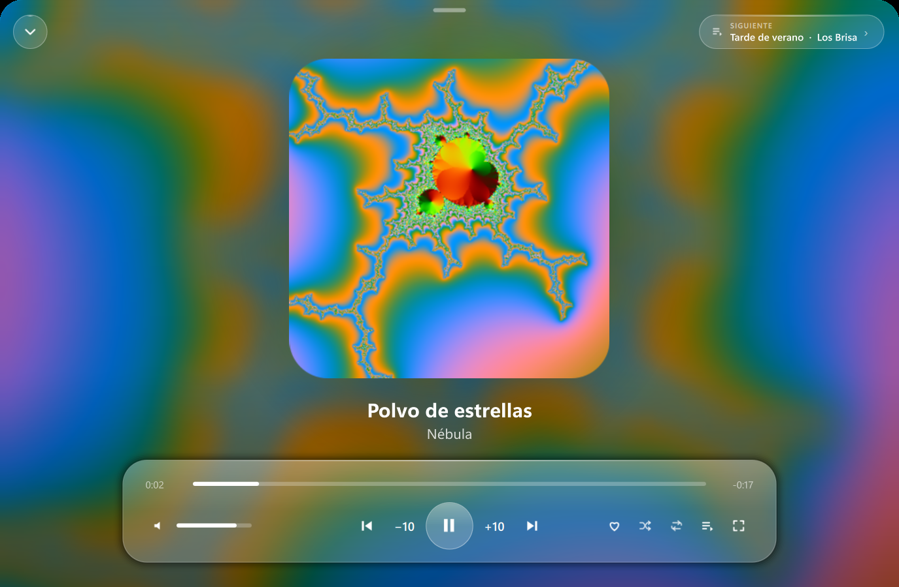
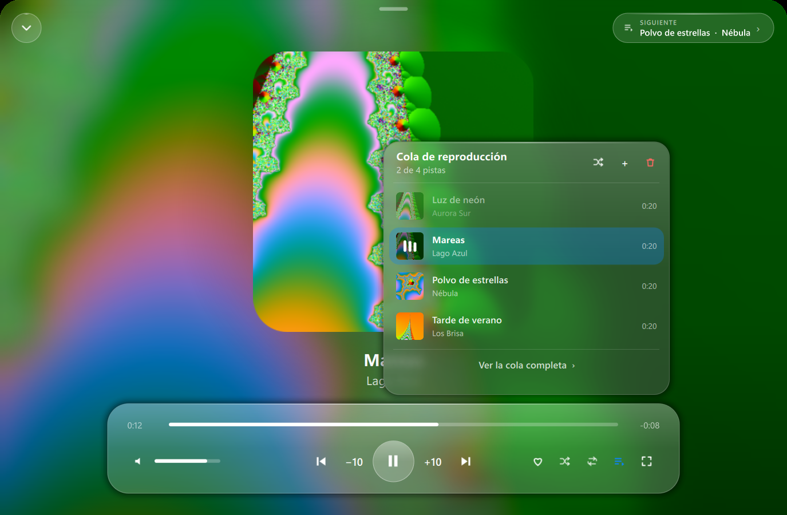
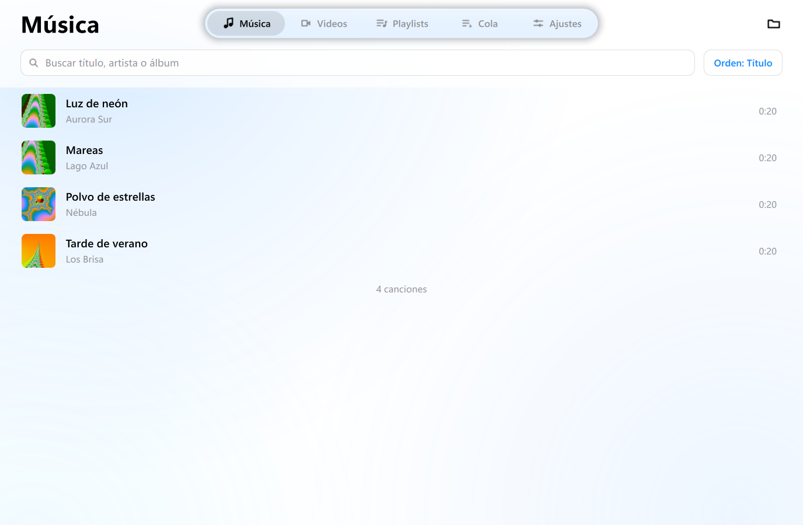
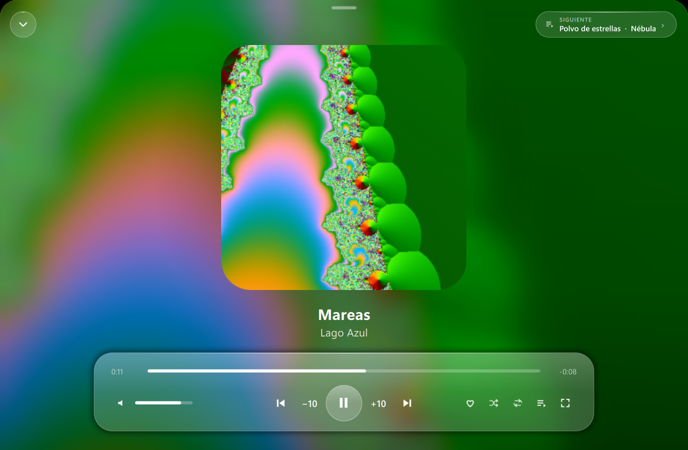
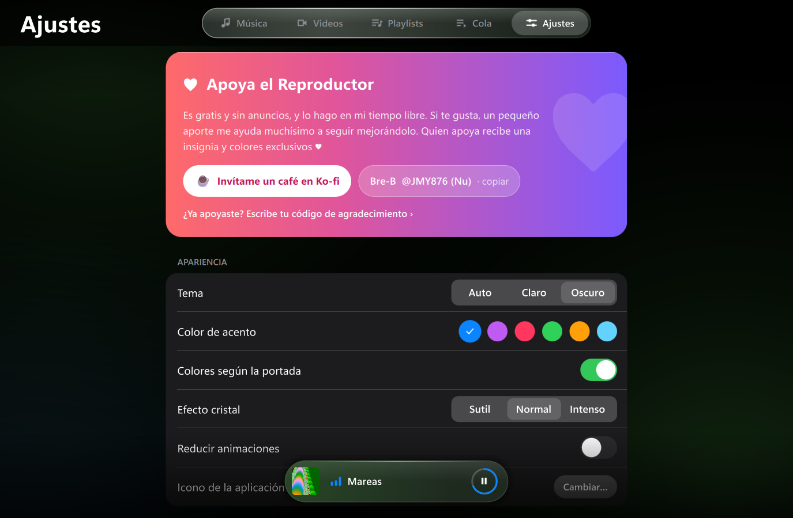

# Reproductor

Reproductor de música y vídeo para Windows, gratuito y sin anuncios.
Creado por **[Julián Andrés Muñoz Armero](https://github.com/julianmunozarmero)**: diseño,
interfaz y desarrollo.

- Biblioteca de música y vídeos con portadas, listas de reproducción y cola.
- Reproduce prácticamente cualquier formato gracias a VLC.
- Interfaz con efecto «liquid glass», modo claro y oscuro, y color de acento.
- Controles multimedia de Windows (teclas de volumen y reproducción, y panel de
  medios).
- Subtítulos y pistas de audio, mini reproductor, y continuar donde lo dejaste.
- Se actualiza solo desde este repositorio.

## Capturas



| | |
|---|---|
|  |  |
|  |  |

## Descargar

**[⬇ Descargar el Reproductor](https://github.com/julianmunozarmero/Reproductor/releases/latest/download/Reproductor-Setup.exe)**: descarga directa del instalador de la última versión.

También puedes ver [todas las versiones y sus novedades](../../releases).

Requisitos: Windows 10 (versión 1809 o posterior) u 11, de 64 bits.

Windows puede mostrar «Windows protegió su PC» porque el instalador todavía no
tiene firma de editor. Pulsa **Más información › Ejecutar de todas formas**.

Para comprobar que tu descarga es la original, compara su huella con el archivo
`.sha256` de la versión:

```powershell
Get-FileHash .\Reproductor-Setup-X.Y.Z.exe
```

## Actualizaciones

El programa busca una versión nueva una vez al día. Cuando hay una, muestra
«Versión X disponible · Actualizar»:

1. La pestaña **Ajustes** muestra un punto rojo y arriba aparece la tarjeta
   «Actualización disponible» con las novedades.
2. Pulsas **Actualizar ahora**: descarga el instalador y comprueba su huella SHA-256.
3. Se instala y el Reproductor se vuelve a abrir solo, con el aviso
   «¡Actualizado a la versión X!».

También puedes buscarla a mano en **Ajustes › Actualizaciones**.

## Apoya el proyecto

El Reproductor es gratis y lo seguirá siendo. Si te resulta útil y quieres
ayudar a que siga mejorando, puedes apoyarlo como prefieras. Es totalmente
opcional. ♥

- **[Invítame un café en Ko-fi](https://ko-fi.com/julianarmero)**: PayPal o tarjeta, desde cualquier país.
- **Bre-B (Colombia):** llave **`@JMY876`** (Nu), desde cualquier banco o Nequi.

Quien apoya recibe un mensaje de agradecimiento con un código. Al escribirlo
en **Ajustes › Apoya el proyecto** se desbloquean la insignia «Apoyas el
Reproductor» y colores exclusivos.

## Licencias de terceros

Usa VLC (LGPL/GPL), Qt (LGPL) y otros componentes de código abierto. Sus
licencias se instalan con el programa: **Ajustes › Acerca de › Licencias de
terceros**.

---

© 2026 Julián Andrés Muñoz Armero. Se puede descargar, usar y compartir gratis; por favor
enlaza a este repositorio en lugar de subir el instalador a otros sitios, así
todos reciben las actualizaciones.
